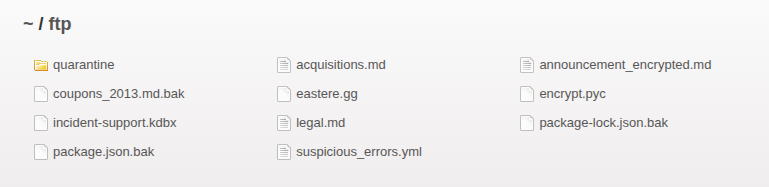
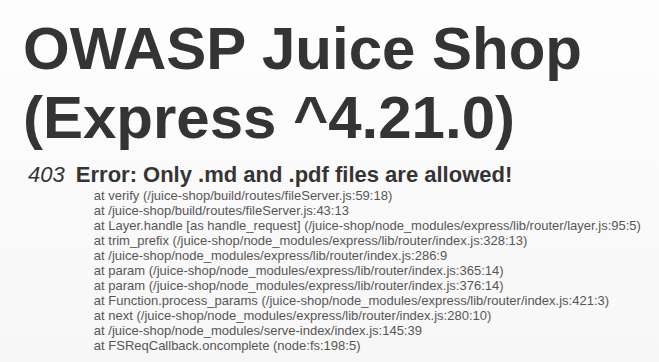

## [Improper Input Validation] - [Poison Null Byte]

## General Information

* **Difficulty Level :**  ⭐⭐⭐⭐ / 6

* **Date of Resolution :** 26-03-2026

---

## Vulnerability Analysis

* **Vulnerability's name :** Poison Null Byte Injection / Double Encoding Bypass

* **Affected components :** File Handling Endpoint (`/assets/public/images/uploads/`)

* **Severity :** <span style="color:red"> High </span>

---

## Proof of Concept (PoC)

#### 1. Enumeration & Techniques

* **Techniques used :** Input Manipulation, Path Traversal, Double URL Encoding
* **Tools used :** Web browser

#### 2. Reproduction Steps

**Step 1 : Understanding File Access Mechanism**

In the application, when `f12` is pressed, you can access the main.js file in the Sources. You can find the information that there is a path to a directory named ftp. In this directory, you can find multiples files not accessible because of their type. The server enforces a restriction on file extensions (.png,  .jpg, ...) to ensure only images are accessed.






**Step 2 : Access Restriction Bypass**

To bypass this restriction, we will use the Null Byte Injection method. For this, we have to add a null byte when trying to open the file.  For this, we have to add `%2500` at the end of the file we want to open. 25 is the hex code for the % character, so %25 decodes to %. Combined with 00, you get the string %00.

```
https://ctf.juice.cyber.epitest.eu/ftp/[filename]%2500.md
```

---

## Risk Assessment

* **Business Impact :** 
Exposure of sensitive internal files such as reports, configuration files, or logs. This can lead to information disclosure, credential leaks, and facilitate further attacks.

* **Technical Description of the Impact :** 
The application fails to properly sanitize user input and incorrectly handles encoded characters. By using double encoding (`%2500`), an attacker bypasses input validation and injects a null byte (`%00`) after server-side decoding.

---

## Actions & Remediation

#### Mitigation Strategies

* Reject any input containing encoded null bytes (`%00`, `%2500`, etc)
* Fully decode user input before validation
* Enforce strict allowlists for file access

#### Recommended Fixes
* Perform validation after full decoding of user input
* Use secure file handling mechanisms that do not rely on string temination
* Avoid direct use of user input in file paths
* Implement proper path normalization to prevent traversal (`../`)

#### Security Best Practices

* A03:2021-Injection -> Always validate and sanitize user input
* A05:2021-Security Misconfiguration -> Avoid unsafe file handling mechanisms
* A04:2021-Insecure Design -> Never trust client-controlled file paths