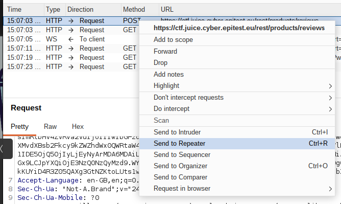
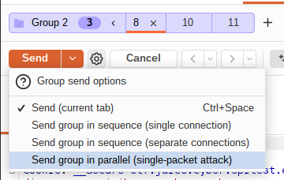

## [Sensitive Data Exposure] - [Forgotten Developer Backup]

## General Information

* **Difficulty Level :** ⭐⭐⭐⭐⭐ ⭐  / 6

* **Date of Resolution :** 26/03/2026

---

## Vulnerability Analysis

* **Vulnerability Name :** Business Logic Flaw / Lack of Rate LImiting

* **Affected Components :** Product Review / Like System

* **Severity :**  Medium 

---

## Proof of Concept (PoC)

#### 1. Enumeration & Techniques

* **Techniques used :** Directory Enumeration, File Discovery, Null Byte Injection
* **Tools used :** Web Browser, Burp Suite ()

#### 2. Reproduction Steps

**Step 1 : Feature Identification

The application allows the user to like product reviews. From the web interface, a user can only like a review once.

**Step 2 : Traffic Interception**

By using Burp Suite, you can bypass this restriction. A request is triggered by clicking the "like" button and is intercepted by Burp Suite. You can send the request multiples time to the repeater to then create a group with all those requests. All you need after is to send the group in parallel.

---
## Risk Assessment

* **Business Impact :** Attackers can manipulate product rating and reviews, misleading users and damaging trust in the platform. This can impact purchasing decisions and harm business credibility.

* **Technical Description of the Impact :** The backend does not enforce constraints implemented on the frontend. By replaying and grouping requests via Burp Suite, an attacker bypasses client-side restrictions and performs unauthorized repeated actions.

---

## Actions & Remediation

#### Mitigation Strategies

   - Enforce server-side validation for user actions

   - Prevent multiple likes from the same user

   - Implement rate limiting on review interactions

#### Recommended Fixes

   - Link each like to a unique user account

   - Implement anti-replay mechanisms

#### Security Best Practices

- A04:2021-Insecure Design  -> Do not rely on frontend restrictions
- A01:2021-Broken Access Control -> Enforce user action limits
- A05:2021-Security Misconfiguration -> Implement proper request controls