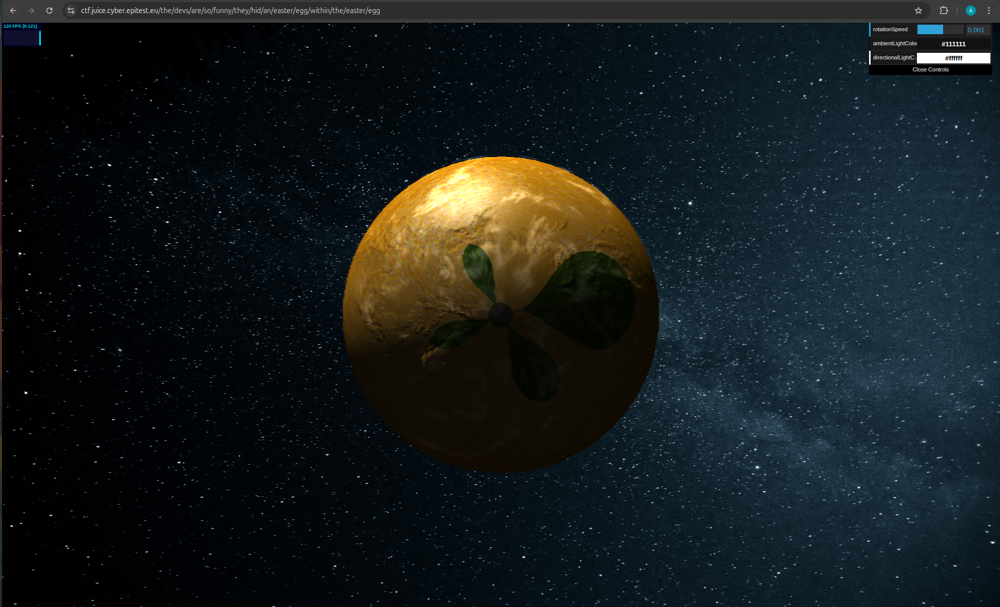

## [Cryptographic Issues] - [Nested Easter Egg]

## General Information

* **Difficulty Level :** ⭐⭐⭐⭐ / 6

* **Date of Resolution :** 31/03/2026

---

## Vulnerability Analysis

* **Vulnerability Name :** Hidden Functionality

* **Affected Components :** Easter Egg Feature

* **Severity :** <span style="color:orange"> Medium </span>

---

## Proof of Concept (PoC)

#### 1. Enumeration & Techniques

* **Techniques used :** Caesar cipher Decoding, Base64 Decoding
* **Tools used :** Web Browser, Online Decoder (`dCode`)

#### 2. Reproduction Steps

**Step 1 : Initial Easter Egg Discovery

An initial Easter Egg is discovered within the application.

``` 
"Congratulations, you found the easter egg!"
- The incredibly funny developers

...

...

...

Oh' wait, this isn't an easter egg at all! It's just a boring text file! The real easter egg can be found here:

L2d1ci9xcmlmL25lci9mYi9zaGFhbC9ndXJsL3V2cS9uYS9ybmZncmUvcnR0L2p2Z3V2YS9ndXIvcm5mZ3JlL3J0dA==

Good luck, egg hunter!
```

By analizing the hidden encoded string with an online decoder like `dCode`, we can find the possible coding method.

**Step 2 : First Layer - Base64**

The hidden encoded string seems to be coded with Base64. After decoding, a new string is obtained :

```
/gur/qrif/ner/fb/shaal/gurl/uvq/na/rnfgre/rtt/jvguva/gur/rnfgre/rtt
```

The output is still not readable, indicating an additional encoding layer. By analizing the hidden encoded string with an online decoder like `dCode`, we can find the possible coding method.

**Step 3 : Second Layer - Caeser Cipher**

The hidden encoded string seems to be coded with Caesar Cipher. After decoding with 13 as the key, a new string is obtained :

```
/the/devs/are/so/funny/they/hid/an/easter/egg/within/the/easter/egg
```

**Step 4 : Nested Easter Egg Validation**

The decoded string can be appended to the base application URL, which reveal a hidden feature : a new website with a planet.



---
## Risk Assessment

* **Business Impact :** Not really any business impact, it's just a fun nested easter egg.

* **Technical Description of the Impact :** Not really any impact, it's just a fun nested easter egg.

---

## Actions & Remediation

#### Mitigation Strategies

   - Avoid using encoding as a security mechanism

   - Do not rely on reversible transformations to hide sensitive data

#### Recommended Fixes

   - Use strong encryption instead of encoding when confidentiality is required

   - Ensure hidden features do not expose meaningful internal data

#### Security Best Practices

  - A02:2021-Cryptographic Failures → Encoding ≠ Security

  - A04:2021-Insecure Design → Avoid hidden logic in production