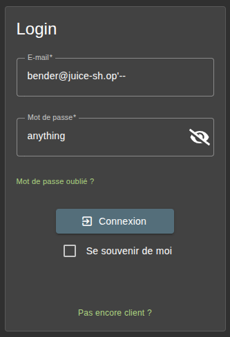

## [Injection] - [Login Bender]

## General Information

* **Difficulty Level :** ⭐⭐⭐ / 6

* **Date of Resolution :** 25-03-2026

---

## Vulnerability Analysis

* **Vulnerability Name :** Weak Security Answer / SQL Injection

* **Affected Components :** Login Form, Bender's account

* **Severity :** <span style="color:red"> High </span>

---

## Proof of Concept (PoC)

#### 1. Enumeration & Techniques

* **Techniques used :** SQL Injection, Authentication Bypass
* **Tools used :** Web Browser

#### 2. Reproduction Steps

**Step 1 : Identifying the Target**

On the admin account, there is a list of all the users and their emails address. Bender's password can be found there (`bender@juice-sh.op`). If you try to reset his password, a security question is asked : "`Company you first work as adult`". We do not have this information, so we must find another way.

**Step 2 : Authentification Bypass**

To login as Bender, we are going to use the SQL Injection method.



- `'` → closes the original SQL query string
- `--` → comments out the rest of the query
This effectively removes the password check.

**Step 3 : Backend view**

The backend likely executes a query similar to:

``` SQL
SELECT * FROM Users WHERE email = 'bender@juice-sh.op'--' AND password = '...'
```

But everything after `--` is ignored so the result query is:

``` SQL
SELECT * FROM Users WHERE email = 'bender@juice-sh.op'
``` 

---

## Risk Assessment

* **Business Impact :** An attacker can gain full control of an user accounts without knowing the original password. This leads to data breaches, unauthorized orders.

* **Technical Description of the Impact :** Security concerns are often irrelevant when it comes to authentication. The application does not properly sanitize user input before including it in SQL queries.. This allows attackers to manipulate the query logic and bypass authentication mechanisms.

---

## Actions & Remediation

#### Mitigation Strategies

   - Use parameterized queries (prepared statements)

   - Sanitize and validate all user inputs
#### Recommended Fixes

   - Avoid dynamic SQL query construction
   
   - Add monitoring for suspicious login attempts

#### Security Best Practices

  - A03:2021-Injection -> Prevent SQL injection via input validation

  - A05:2021-Security Misconfiguration -> Avoid insecure query handling
  
  - A07:2021-Identification and Authentication Failures -> Secure authentication mechanisms
